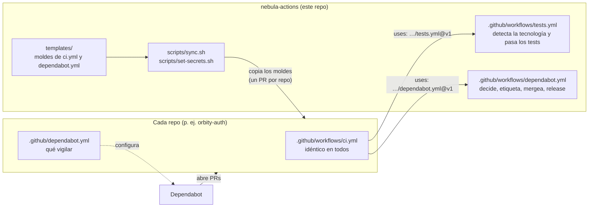
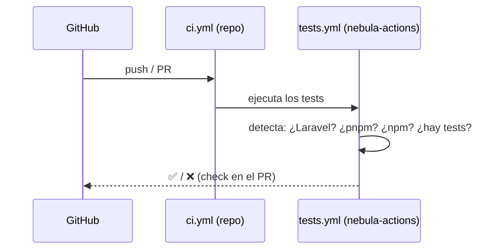
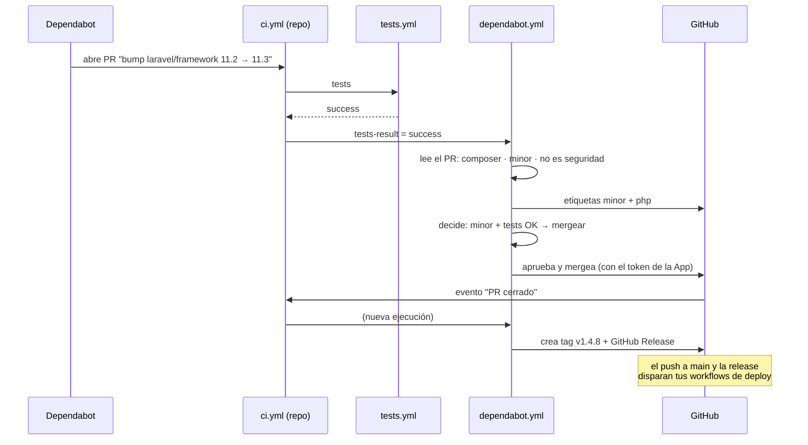
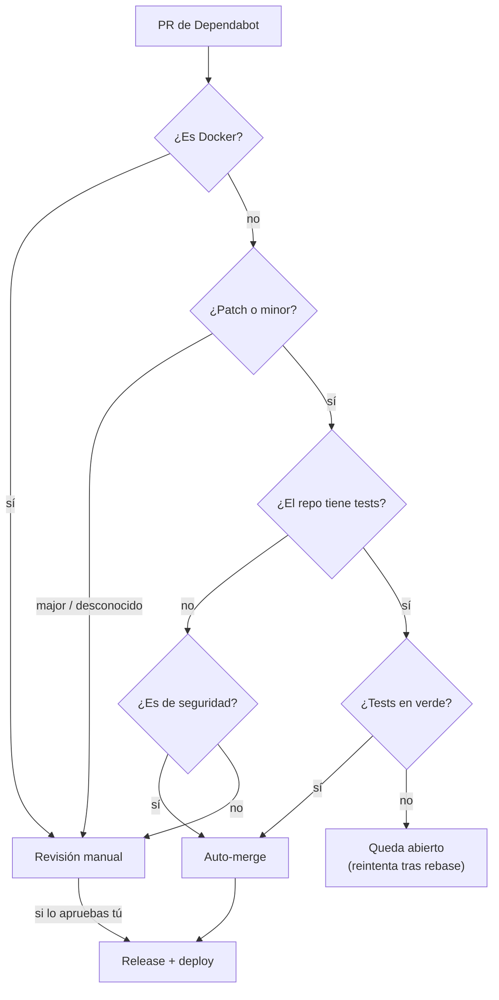

# Guía: cómo funciona y cómo se implementa

Esta guía explica el sistema desde cero. Para la referencia rápida (entradas, opciones, contenido del repo), ver el [README](../README.md).

## 1. Qué problema resuelve

Cada repo de Nebula-Syst depende de decenas de paquetes (npm, Composer) y de imágenes Docker que reciben actualizaciones y parches de seguridad constantemente. Revisarlos a mano en 15 repos no es viable.

Con este sistema:

- **Dependabot** (de GitHub) abre PRs con las actualizaciones.
- **Los tests de cada repo** deciden si una actualización es segura.
- Lo seguro (patch y minor con tests en verde) **se mergea solo**, y genera release y deploy.
- Lo arriesgado (versiones major y Docker) **te espera a ti**, etiquetado y explicado.

## 2. Conceptos de GitHub que hay que tener claros

| Concepto | Qué es |
| --- | --- |
| **Workflow** | Un archivo `.yml` dentro de `.github/workflows/` de un repo. GitHub lo ejecuta cuando pasa algo: un push, un PR… |
| **Job** | Cada bloque de trabajo de un workflow. Se ejecuta en una máquina de GitHub y consume minutos. |
| **Workflow reutilizable** | Un workflow que no se lanza solo, sino que **otro workflow lo llama** con `uses: org/repo/.github/workflows/x.yml@versión`. Se ejecuta **dentro del repo que lo llama**: su código, sus secretos, sus minutos. El repo donde vive solo guarda las instrucciones. |
| **Dependabot** | El bot de GitHub que abre los PRs de actualización. Lee su configuración de `.github/dependabot.yml` de cada repo; no hay forma de compartirla. |
| **Tag / versión** | Una etiqueta (`v1.2.0`) sobre un commit. Los repos llaman a `nebula-actions` con `@v1`, un tag que se mueve solo a la última `v1.x.y`: un cambio aquí llega a todos en cuanto publicas una versión. |

## 3. Las piezas



- **En vivo** (en cada push o PR) solo se usan los dos workflows reutilizables. `ci.yml` los llama.
- **Las plantillas y los scripts** solo se usan al instalar o actualizar los archivos de un repo. Si borraras `templates/`, los repos seguirían funcionando.

### Qué hace cada archivo de un repo

**`ci.yml`** es igual en todos los repos y no contiene lógica. Dice:

1. En cada push a `main` y en cada PR, ejecuta `nebula-actions/tests.yml`.
2. Si el PR es de Dependabot, ejecuta después `nebula-actions/dependabot.yml` y le pasa el resultado de los tests.

**`dependabot.yml`** le dice a Dependabot qué vigilar y cuándo: npm/pnpm, Composer si es Laravel, Docker si hay carpeta `docker/`, y siempre GitHub Actions. Todo los lunes a las 06:00, salvo las vulnerabilidades, que llegan al momento. Cambia de un repo a otro solo en esos ecosistemas.

## 4. Qué pasa, paso a paso

### Un push a `main` o un PR tuyo



Es el CI normal: ves el check de tests en el PR, como siempre.

### Un PR de Dependabot



Cómo decide `dependabot.yml`:



En los PRs de Docker no se pasan los tests de la app, porque no usan la imagen. En su lugar se compilan todos los Dockerfile, se descargan las imágenes del compose y, si existe, se ejecuta `docker/smoke.sh`.

### Dónde ver qué ha pasado

En el repo, pestaña **Actions**, abre la ejecución de *CI* del PR. En **Summary** verás:

- `🧪 Tests (laravel)`, o `⚪ Sin tests que ejecutar`
- `✅ Auto-merge`, o `✋ Revisión manual: <motivo>`, con una tabla de dependencias, tipo y ecosistema
- `🏷️ Release v1.4.8`

## 5. Implementación

### 5.1 Una sola vez, para toda la org

1. **Publicar `nebula-actions`** con un tag `v1.x.y`. `major-tag.yml` crea o mueve `v1`, que es al que apuntan los `ci.yml`; si no existe, fallan.
   ```bash
   git tag v1.1.0 && git push origin v1.1.0
   ```
2. **Crear la GitHub App** (pasos en el README). Es gratis. Sin ella el sistema funciona, pero:
   - los merges automáticos **no disparan** deploy ni release, porque GitHub no lanza workflows por acciones de su token interno;
   - no se pueden mergear PRs que tocan `.github/workflows`. Las versiones `v1.x.y` llegan igual por el tag `@v1`; solo el salto a `@v2` hay que mergearlo a mano.
3. **Instalar `gh`** en tu máquina (`gh auth login`) para usar los scripts.

### 5.2 Por cada repo

```bash
# desde tu clon de nebula-actions
gh repo edit Nebula-Syst/orbity-auth --add-topic nebula-deps
bash scripts/set-secrets.sh <app-id> ~/ruta/clave.pem orbity-auth
bash scripts/sync.sh --dry-run orbity-auth    # revisa qué va a cambiar
bash scripts/sync.sh orbity-auth              # abre el PR
```

| Paso | Qué hace |
| --- | --- |
| Topic `nebula-deps` | Marca el repo como gestionado. Los scripts, sin argumentos, actúan sobre todos los repos con el topic. |
| `set-secrets.sh` | Guarda `DEPS_APP_ID` y `DEPS_APP_PRIVATE_KEY` en el repo **dos veces**, como secreto de Dependabot y de Actions. En GitHub Free los secretos de organización no llegan a repos privados. |
| `sync.sh` | Clona el repo, detecta qué usa, escribe `ci.yml` y `dependabot.yml`, borra lo que sustituyen y abre un PR. |

Luego:

1. **Revisa el PR que abre `sync.sh`.** Ese mismo PR ya ejecuta el `ci.yml` nuevo, así que verás los tests funcionando antes de mergear.
2. **Mergéalo.**
3. En el repo, ve a **Settings → Code security** y activa **Dependabot security updates**.
4. **Pruébalo:** en un PR de Dependabot abierto, comenta `@dependabot recreate`. Si no hay ninguno, espera al lunes.

#### Requisitos del proyecto

- **Node**: un script `test` en `package.json` con tests de verdad. Si es `echo ok`, todo se auto-mergea sin validar nada.
- **Laravel**: `.env.example`, tests que funcionen con MySQL 8, y `config.platform.php` en `composer.json` con la versión de producción, para que Dependabot no proponga paquetes de un PHP más nuevo.
- **Docker**: los Dockerfile dentro de `docker/` y construibles desde la raíz del repo. Recomendado: fijar el digest de las imágenes base (`FROM node:24-alpine@sha256:…`).

#### Repos con tests especiales

Si un repo necesita otra cosa (Postgres, arrancar la imagen, un monorepo como Forvia…), deja su propio `tests.yml` o `test.yml` y añádele `workflow_call:` en el `on:`. `sync.sh` lo detecta y hace que `ci.yml` llame a ese workflow en lugar del de `nebula-actions`.

## 6. Día a día

| Cuándo | Qué hacer |
| --- | --- |
| Cada lunes (unos 15 min) | Revisa los [PRs abiertos de Dependabot en la org](https://github.com/pulls?q=is%3Aopen+is%3Apr+org%3ANebula-Syst+author%3Aapp%2Fdependabot). Decide sobre los `major` y `docker`. Un patch o minor que sigue abierto significa que sus tests fallaron: mira por qué. |
| Llega un PR de una versión impar de Node | No debería: está ignorada en `dependabot.yml`. |
| Quieres cambiar la lógica | Cámbiala en `nebula-actions` y publica un tag `v1.x.y`: todos los repos la usan en su siguiente ejecución. Si es incompatible, `v2.0.0`: cada repo recibe un PR de Dependabot para revisarlo. |
| Quieres cambiar `ci.yml` o `dependabot.yml` de todos | Cambia `templates/` y ejecuta `bash scripts/sync.sh`: abre un PR en cada repo. |
| Rotas la clave de la App | `bash scripts/set-secrets.sh <app-id> <nueva.pem>` |

## 7. Problemas frecuentes

| Síntoma | Causa probable | Qué hacer |
| --- | --- | --- |
| Todos los CI fallan con *"unable to find reusable workflow"* | El tag `v1` de `nebula-actions` no existe | Mira la ejecución de *Tag de versión mayor* en `nebula-actions`, o créalo: `git tag -f v1 v1.x.y && git push -f origin v1` |
| Todos los CI empiezan a fallar a la vez | La última versión publicada tiene un fallo | Arréglalo y publica otra versión, o vuelve atrás: `git tag -f v1 <versión-buena> && git push -f origin v1` |
| PR patch o minor que no se mergea | Tests en rojo | Mira el job de tests. Si el fallo es real, arréglalo en una rama propia; Dependabot rebasea y se reintenta |
| *"Revisión manual: Repo sin tests"* | El repo no tiene script `test` o `tests/*Test.php` | Normal: sin tests, solo se auto-mergean vulnerabilidades |
| Se mergea pero no despliega ni crea release | Falta la GitHub App o sus secretos en ese repo | `set-secrets.sh` para ese repo |
| PR de `github-actions` que no se mergea | Sin App, `GITHUB_TOKEN` no puede tocar workflows | Configura la App, o mergéalo a mano |
| Laravel: `requires php >=8.4` en `composer install` | Dependabot resolvió con un PHP más nuevo | Añade `config.platform.php` en `composer.json` y comenta `@dependabot recreate` |
| PR de Docker en rojo | Un Dockerfile no compila (a veces el de `docker/dev`, si necesita un `.env`) | Mira el job *Docker build*. Nunca se auto-mergea, así que no rompe nada |
| `sync.sh` dice *"es propio: no se toca"* | El archivo no lleva la marca `# nebula-actions: managed` | Es intencionado. Para que lo gestione, bórralo o ponle la marca |
| Se acaban los minutos de Actions | Repos privados en GitHub Free (unos 2.000 al mes) | Revisa **Settings → Billing**. Los repos públicos no gastan |
